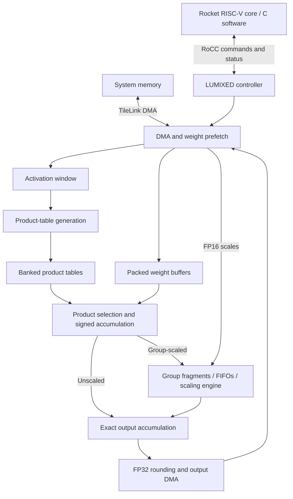

# LUMIXED

**LUT-based mixed-precision matrix multiplication accelerator for quantized neural networks.**

`RISC-V / RoCC` · `Chisel / SystemVerilog` · `Chipyard 1.15.0` · `Verilator` · `FPGA`

[Architecture](#architecture) · [Quick start](#quick-start) · [Software interface](#software-interface) · [Python model](#python-performance-model) · [Evaluation](#evaluation) · [Project status](#project-status)

> **Research project — active development.** Functional RTL verification, a calibrated Python performance model and initial FPGA synthesis results are available. Scaling hardware optimization, implementation timing and further software integration are ongoing. Archived measurements are tied to their original hardware revisions.

## Overview

LUMIXED accelerates matrix multiplication by replacing repeated activation–weight multiplications with reusable lookup-table products. It generates products for an activation window, stores them in on-chip memories, selects products using packed quantized weights, and accumulates the results. Lower weight precision allows more activation positions to be covered by the same product-table capacity.

The accelerator is integrated with a Rocket RISC-V core through the RoCC interface and uses TileLink DMA to transfer activations, weights, scales and results.

| Capability | Supported design |
|---|---|
| Activations | INT8/INT16 or FP16/FP32, selected at elaboration |
| Weights | Packed signed INT8/INT4/INT2, runtime selectable |
| Floating-point output | FP32, round-to-nearest, ties-to-even |
| Group-wise quantization | Finite FP16 scales, optional aligned or deferred scheduling |
| Group size | 32, 64 or 128, runtime selectable in scaled builds |
| Parallelism | Configurable banks per row (B), parallel rows (YS), table capacity (RF) |
| Integration | Rocket, RoCC ABI v2, TileLink DMA, bare-metal C |
| Evaluation | Verilator, Python performance model, Vivado out-of-context synthesis |

The main matched benchmark campaign uses **FP32 activations, signed W8/W4/W2 weights and FP32 outputs**, with and without deferred FP16 group scaling. Other supported modes and optional scheduling features have different validation coverage.

## Architecture

### Original architecture


*Figure 1 — Original manuscript dataflow. The central lookup-table reuse principle remains relevant.*

> **Figure status:** The original manuscript figures below are reused unchanged from the earlier LUMAX repository. They illustrate the original architectural ideas, not the exact current Chipyard 1.15.0 RTL. Some details need updating, especially FP16/FP32 arithmetic, multi-row parallelism, group scaling, SRAM accumulation and the revised RoCC/DMA interfaces. See the [original figure provenance](https://github.com/IoannouKon/LUMAX/blob/7b6e6c8c9f8484693180fe4b5806f4a58ba6984d/docs/README.md).

### Current system overview

The following conceptual diagram reflects the newer architecture, including the optional group-scaling path.



The computation pipeline overlaps weight loading with product selection. In deferred group-scaling mode, completed bank fragments are buffered and scaled independently of selection, subject to available FIFO capacity.

For floating-point activations, LUMIXED decodes IEEE significands and exponents, computes exact integer partial sums, and rounds the accumulated result once to FP32. With symmetric group-wise quantization, the arithmetic contract is:

```text
O[r,n] = FP32_RNE(sum_g S[g,n] * sum_(k in g) X[r,k] * W[k,n])
```

This exact-reference contract differs from conventional running FP32 accumulation and from inference kernels that may internally quantize activations.

### Product-table reuse


*Figure 2 — Legacy product selection and reuse across weight columns. The figure is conceptual; use the current RTL for the exact address calculation, signed correction and floating-point exponent alignment.*

### Pipelining and weight prefetch


*Figure 3 — Legacy timing illustration of overlapping stages and double buffering. The current controller adds tagged pipeline retirement and optional scaling queues; the figure is not a current cycle-accurate timing diagram.*

### RTL entry points

| Source | Responsibility |
|---|---|
| [Config.scala](src/main/scala/Config.scala) | Hardware capacities, formats and feature flags |
| [LUMIXED_Top.scala](src/main/scala/LUMIXED_Top.scala) | RoCC accelerator, controller and compute datapath |
| [Product_Generator.scala](src/main/scala/Product_Generator.scala) | Reusable product-table generation |
| [DMA.scala](src/main/scala/DMA.scala) | TileLink transactions and ordered DMA delivery |
| [GroupScaleEngine.scala](src/main/scala/GroupScaleEngine.scala) | Group partials, fragment queues, scale lookup and scaling |
| [ExactScaleMultiplier.scala](src/main/scala/ExactScaleMultiplier.scala) | Parameterized mixed-width signed scaling multiplication |
| [OutputAccumulator.scala](src/main/scala/OutputAccumulator.scala) | Banked exact output accumulation and forwarding |
| [FP16.scala](src/main/scala/FP16.scala) | IEEE FP decoding and fixed-point-to-FP32 conversion |

## Quick start

### 1. Set up Chipyard

LUMIXED lives inside this Chipyard fork; it is not a standalone Scala project.

```bash
git clone --branch feature/lumixed-integration https://github.com/IoannouKon/chipyard.git
cd chipyard
./build-setup.sh
source env.sh
```

Use a Linux environment with the Chipyard toolchain, Java/SBT, CIRCT, Verilator and a RISC-V bare-metal compiler. Follow the [Chipyard setup documentation](https://chipyard.readthedocs.io/) for host prerequisites. If your workspace is already configured, skip installation and source `env.sh`.

### 2. Configure the hardware

Edit [Config.scala](src/main/scala/Config.scala). The checked-in default configuration is intended for small FP32, deferred-group-scaled tests:

| Parameter | Default | Meaning |
|---|---:|---|
| `Rin / Cin / Cout` | 32 / 256 / 32 | Maximum R / K / N |
| `FP_ACTIVATIONS / FP_BITS` | true / 32 | Activation format |
| `banks_per_row` | 4 | B |
| `table_capacity_factor` | 4 | RF |
| `parallel_rows` | 1 | YS |
| `GROUP_SCALE_YS` | 1 | Scaling multipliers: 1..YS; YS preserves full parallelism |
| `Dma_Ids` | 2 | Shared DMA source slots |
| `DMA_Bytes / W_BUFFS` | 8 / 2 | DMA beat size / weight buffers |
| `DEBUG` | true | Hardware performance counters |
| `GROUP_SCALE_ALIGNED` | false | Group-aligned window scheduling |
| `GROUP_SCALE_DEFERRED` | true | Deferred fragment scaling |

Change build-time parameters before rebuilding the simulator. Runtime dimensions must fit the configured capacities. For unscaled hardware, set **both group-scaling flags to false** and rebuild. The two group modes are mutually exclusive.

`GROUP_SCALE_YS` is a build-time setting. With group scaling enabled, a fragment is processed in `ceil(parallel_rows / GROUP_SCALE_YS)` row batches. Reduced scaler counts preserve exact arithmetic but can add FIFO backpressure and window-drain cycles; they do not change the software API.

Output accumulators always use synchronous SRAM with a four-entry output DMA prefetch queue; register-based output storage is no longer supported.

For group scaling, keep fixed bank grouping and 8-byte DMA. The RTL currently requires zero skipping, weight bursts and early buffer release to be disabled in these builds.

### 3. Run a hardware smoke test

From the Chipyard root, with the default configuration and environment loaded:

```bash
cd generators/LUMIXED/software/tests/src

# X[2,256] × W[256,4], FP32 activations, W8, FP16 scales, G=128
GROUP_SIZE=128 FAST_VECTORS=1 REBUILD=1 bash ./run_param_test.sh 2 256 4 32 8

# Reuse the same simulator with W4 and W2
GROUP_SIZE=128 FAST_VECTORS=1 REBUILD=0 bash ./run_param_test.sh 2 256 4 32 4
GROUP_SIZE=128 FAST_VECTORS=1 REBUILD=0 bash ./run_param_test.sh 2 256 4 32 2
```

The first test builds the hardware simulator, generates deterministic inputs and an independent exact Python reference, compiles the RISC-V C harness, runs the RTL and compares every output bit. A successful run ends with `TEST [PASS]`.

The argument order is:

```text
run_param_test.sh R K N ACTIVATION_BITS WEIGHT_BITS [debug]
```

| Environment variable | Purpose |
|---|---|
| `REBUILD=auto/1/0` | Rebuild as needed / force rebuild / reuse matching simulator |
| `BUILD_JOBS=2` | Parallel build jobs |
| `FAST_VECTORS=1` | Independent Python reference (required for FP32/group scaling) |
| `GROUP_SIZE=32/64/128` | Quantization group size |
| `TEST_SEED=1` | Reproducible inputs |
| `TEST_PATTERN=2` | Randomized signed weights |
| `QUIET_TEST=0` | More verbose test output |

Logs are written under `software/tests/src/Log/` by default. The runner edits test macros in `lumixed_matmul_test.c` and generates local test files; use separate worktrees for parallel experiments. Use `REBUILD=0` only when the simulator matches the hardware configuration.

**Toolchain note:** the medium Rocket configuration has no FPU. Use the matching soft-float LP64 HTIF compiler/runtime, including the documented Chipyard atexit workaround where needed. See the [bare-metal test guide](software/tests/README.md) and [verification provenance](verification/README.md).

### 4. Build the hardware simulator separately

From the Chipyard root:

```bash
source env.sh
make -C sims/verilator -j2 CONFIG=LUMIXEDRocketConfig
```

The SoC configuration is [LUMIXEDRocketConfig](../chipyard/src/main/scala/config/LUMIXEDConfigs.scala). The default simulator path is `sims/verilator/simulator-chipyard.harness-LUMIXEDRocketConfig`.

For a waveform-enabled simulator, append `debug` to the smoke-test arguments and use `REBUILD=1`.

This is RTL simulation, not physical FPGA execution. For accelerator-only Vivado synthesis, see [Hardware estimation](#hardware-estimation).

## Software interface

The C software configures runtime dimensions, precisions, memory addresses and execution parameters through the RoCC ABI v2 interface.

| Source | Purpose |
|---|---|
| [lumixed_api.h](software/tests/src/lumixed_api.h) | Configure and execute a matrix multiplication |
| [lumixed_rocc.h](software/tests/src/lumixed_rocc.h) | Low-level RoCC commands, status and counters |
| [lumixed_matmul_test.c](software/tests/src/lumixed_matmul_test.c) | Runnable bare-metal example |
| [prepare_test_vectors.py](software/tests/src/prepare_test_vectors.py) | Independent exact-reference test vectors |
| [run_param_test.sh](software/tests/src/run_param_test.sh) | Build and run parameterized RTL tests |

The API call sequence is:

```c
/* Illustrative sequence; see the test harness for types and buffers. */
lumixed_set_group_scales(scales, group_size); /* scaled builds only */
lumixed_configure_matmul(K, R, N, B * RF, YS, X, W, O);
lumixed_execute_matmul(K, R, N, B * RF, YS, X, W, O);
```

Activations and outputs are row-major; signed weights are packed column-major in the accelerator layout. Scales are FP16 bit patterns in group-major order `[ceil(K/G)][N]`, aligned to 8 bytes and padded only at the end of the entire array. Floating-point outputs contain raw FP32 bits.

The separate [QWEN_VERIFY runner](software/QWEN_VERIFY/README.md) supports captured Qwen projection data, isolated Verilator builds, and comparison against the exact reference and native llama.cpp output. It requires an external capture dataset and a prepared Chipyard environment; the dataset is not bundled.

## Python performance model

The [self-contained Python model v8.1](Performance_Model/Model.py) estimates execution cycles without building hardware. It retains the legacy INT16/FP16 event simulator and adds an empirical, stage-calibrated FP32 predictor. Ordinary predictions require Python 3.10+ and no third-party packages.

From the Chipyard root:

```bash
# FP32 × W8, scaling OFF
python3 generators/LUMIXED/Performance_Model/Model.py \
  --r 4 --k 1024 --n 2048 --b 8 --rf 8 --ys 2 --id 8 --w 8 --scale off

# FP32 × W4, deferred FP16 group scaling ON
python3 generators/LUMIXED/Performance_Model/Model.py \
  --r 4 --k 1024 --n 2048 --b 8 --rf 8 --ys 2 --id 8 --w 4 --scale on
```

Example Python use (from `Performance_Model/`):

```python
from Model import compute_cycles

p = compute_cycles(
    4, 1024, 2048, 32, 8, 8, 2, 8,
    factor=8, activation="fp32", group_scale_mode="off",
)
print(p["total_cycles"])
print(p["predicted_stages"])
```

| FP32 model validation | Mean absolute percentage error |
|---|---:|
| Held-out matrix shape | 2.830% |
| Held-out configuration | 5.361% |
| Held-out hardware geometry | 8.051% |

The model was evaluated using 240 archived RTL measurements. These are grouped cross-validation averages, not universal error bounds. Unknown configurations and out-of-domain shapes require explicit extrapolation. The FP32 model is not a cycle-exact simulation of TileLink or the cache hierarchy.

See the [model guide, accuracy breakdown and calibration reproduction](Performance_Model/README.md).

## Evaluation

### RTL verification

The matched FP32 benchmark archive contains the following **pre-V1** Verilator results using synthetic Qwen3-0.6B-shaped inputs:

| Mode | Matmuls passing | Exact FP32 outputs |
|---|---:|---:|
| Group-scaled | 120/120 | 786,432 |
| Unscaled | 120/120 | 786,432 |
| **Total** | **240/240** | **1,572,864** |

Eight configurations (four B/RF/YS geometries, each with DMA IDs 8 and 16) were evaluated across W8/W4/W2 and five representative projection shapes. Group sizes were 32 for W8/W4 and 64 for W2.

The benchmark estimates the cost of 196 transformer weight projections from representative layer shapes. It is **not an end-to-end Qwen inference benchmark**.

- [Verification methodology and results](verification/README.md)
- [Group-scaled stage cycles](verification/QWEN_RESULTS_GROUP_SCALED/matmul_stage_cycles.csv) · [Projection totals](verification/QWEN_RESULTS_GROUP_SCALED/total_cycles.csv)
- [Unscaled stage cycles](verification/QWEN_RESULTS_UNSCALED/matmul_stage_cycles.csv) · [Projection totals](verification/QWEN_RESULTS_UNSCALED/total_cycles.csv)

### Hardware estimation

An accelerator-only Vivado 2023.2 synthesis campaign completed for 18 designs on a common Alveo U250 part: 16 LUMIXED variants and two edited Gemmini comparison designs.

The initial unscaled LUMIXED builds use zero DSPs. The initial scaled builds exhibited excessive DSP inference from the generated multiplier representation. A mixed-width RTL correction has since been introduced in [ExactScaleMultiplier.scala](src/main/scala/ExactScaleMultiplier.scala); its updated Vivado utilization and timing remain unverified.

- [Synthesis methodology, resources and reproduction commands](Hardware_Estimation/Synthesis/README.md)
- [Resource utilization CSV](Hardware_Estimation/Synthesis/resources.csv)
- [Original synthesis reports, logs, RTL and flow archive](Hardware_Estimation/Synthesis/reports.tar.gz)

The archived synthesis data do not establish routed frequency, timing closure, power or physical board operation. The pre-fix DSP counts are not measurements of the corrected RTL.

### Comparison baseline

The [edited Gemmini port](Gemmini_Edited/README.md) is an optional FP32 × signed INT8 baseline with 4×4 and 8×8 weight-stationary arrays. It is archived separately from the standard LUMIXED RTL and requires applying the supplied patch for reproduction.

See the [Gemmini verification and benchmark results](verification/GEMMINI_EDITED_QWEN_W8/README.md). The baseline has different arithmetic and memory organization; comparisons should account for these differences rather than assume identical numerical semantics.

## Repository layout

```text
generators/LUMIXED/
├── src/main/scala/        # Chisel accelerator RTL
├── software/
│   ├── tests/             # RoCC C API, bare-metal tests and vectors
│   └── QWEN_VERIFY/       # Captured-Qwen verification runner
├── Performance_Model/     # Standalone Python cycle prediction
├── verification/          # Archived functional and cycle evidence
├── Hardware_Estimation/   # Vivado synthesis evidence
└── Gemmini_Edited/        # Optional comparison hardware port
```

## Project status

| Component | Status |
|---|---|
| Chipyard integration and RoCC API | Implemented |
| FP32 / W8-W4-W2 exact RTL verification | Matched benchmark archive complete |
| Deferred FP16 group scaling | Implemented; hardware optimization ongoing |
| Python performance model | Available; further calibration ongoing |
| FPGA resource estimation | Initial synthesis complete |
| Mixed-width scaling fix and timing closure | Updated Vivado evaluation pending |
| Optional scheduling features | Experimental; not all combinations validated |
| Full llama.cpp backend / end-to-end inference | Not available as a complete backend |
| Physical FPGA deployment | Not established by the current archive |

## Further reading

- [Chipyard documentation](https://chipyard.readthedocs.io/)
- [Original LUMAX research repository](https://github.com/IoannouKon/LUMAX)
- [Original manuscript figures and attribution](https://github.com/IoannouKon/LUMAX/blob/7b6e6c8c9f8484693180fe4b5806f4a58ba6984d/docs/README.md)
- [Hardware configuration](src/main/scala/Config.scala)
- [Bare-metal software and testing guide](software/tests/README.md)
- [Python performance model documentation](Performance_Model/README.md)
- [Verification archive](verification/README.md)
- [Synthesis evidence](Hardware_Estimation/Synthesis/README.md)

LUMIXED is an ongoing research and engineering project. Feedback, reproducible bug reports and technical discussions are welcome.
